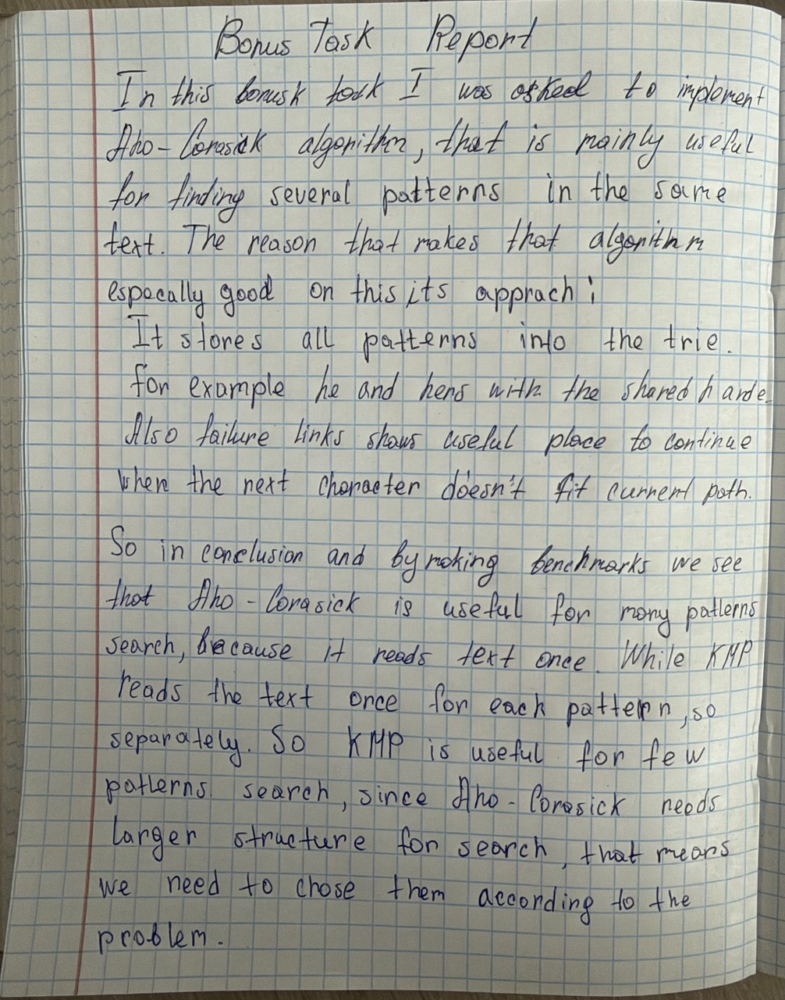

# Handwritten report


# Aho-Corasick and KMP

This Java project finds all occurrences of multiple patterns, including overlaps. Each match contains the pattern index and starting text index. Duplicate patterns keep separate indices. Empty or null patterns are rejected; an empty pattern list is allowed. Positions use Java UTF-16 code units.

## How it works

Aho-Corasick stores patterns in a trie, sharing nodes for common prefixes. Terminal nodes store the indices of patterns ending there. Failure links point to the longest proper suffix of the current path that is also a trie prefix. A queue builds these links in breadth-first order: root children fail to the root, and deeper nodes use their parent's failure chain to find the next valid transition.

The search reads the text once. When a transition is missing, it follows failure links without moving backward in the text. It reports patterns at the current node and follows output links to report shorter patterns ending at the same position. KMP instead builds a prefix table for each pattern and searches the text separately for each one.

## Complexity

Let `S` be the total pattern length, `L` the longest pattern length, `P` the number of patterns, `N` the text length, and `Z` the number of matches. Map operations are assumed to take expected constant time.

| Operation | Time | Space |
|---|---|---|
| Build the trie | `O(S)` | `O(S)` |
| Build failure/output links as written | Conservative bound `O(SL)` | `O(S)` |
| Aho-Corasick search | `O(N + Z)` | `O(Z)` for returned matches |
| Build all KMP prefix tables | `O(S)` | `O(S)` |
| Run KMP for every pattern | `O(PN + Z)` | `O(Z)` for returned matches |

Our sparse failure-link builder may walk up to `L` failure links per edge. A complete transition-table implementation can achieve linear construction for a fixed small alphabet, using more transition storage. During searching, failure steps reduce the current path length, so their total is linear in `N`. Output links add work proportional to `Z`. The trie and its links use `O(S)` space; including returned matches, both implementations use `O(S + Z)` space.

## Experiments and results

All nine combinations use 10, 100, or 1,000 patterns and texts of 1,000, 10,000, or 100,000 characters. The alphabet is `abcd`; pattern lengths range from 4 to 12. Half the patterns are sampled from the text, and the rest are random and may also occur. Duplicates are allowed.

The fixed base seed is `20261115`; each case uses `base seed + pattern count * 1000003 + text length`. Both algorithms receive identical inputs. Five warm-ups precede five measured runs using `System.nanoTime()`, with alternating algorithm order. Construction and search are timed separately, including match allocation. Generation, correctness comparisons, file writing, and console output are outside timing. The recorded run used OpenJDK 26.0.2.1 on macOS.

The table shows average construction-plus-search time in milliseconds. [The full CSV](results/benchmark.csv) includes separate construction/search timings and match counts.

| Patterns | Text length | Aho-Corasick total (ms) | KMP total (ms) |
|---:|---:|---:|---:|
| 10 | 1,000 | 0.249883 | 0.273675 |
| 10 | 10,000 | 0.572133 | 0.586483 |
| 10 | 100,000 | 2.044367 | 5.353042 |
| 100 | 1,000 | 0.413250 | 0.444733 |
| 100 | 10,000 | 0.420883 | 5.308525 |
| 100 | 100,000 | 2.529692 | 53.960909 |
| 1,000 | 1,000 | 0.688650 | 4.430958 |
| 1,000 | 10,000 | 0.998034 | 53.395209 |
| 1,000 | 100,000 | 5.347234 | 535.867408 |

Aho-Corasick had lower average total time in all nine cases. Its advantage was largest with many patterns and long texts: about 5.35 ms versus 535.87 ms in the largest case. KMP preprocessing was faster in every case, but it repeats the text scan for each pattern. KMP is simpler for one or a few patterns; Aho-Corasick is useful for many patterns and can reuse its built trie across texts. Its maps and nodes add memory overhead, and changing patterns requires rebuilding this implementation. Many matches also increase output time and memory. JVM compilation, garbage collection, and machine load affect short timings, so these values describe this run rather than a guarantee.

## Tests and running

Tests cover shared prefixes, suffix matches, overlaps, duplicates, absent and longer patterns, empty inputs, invalid patterns, and repeated searches. Each test program also checks 200 fixed-seed random cases against a simple search. Before timing, the benchmark checks that both algorithms return exactly the same occurrences. Both test programs passed; compilation produced no warnings.

Use Java 11 or later, from the project root:

```sh
mkdir -p out
javac -Xlint:all -d out src/matching/*.java src/benchmark/*.java tests/*.java
java -cp out AhoCorasickTests
java -cp out MatcherComparisonTests
java -cp out benchmark.Benchmark
```

The benchmark overwrites `results/benchmark.csv`. An optional output path preserves the existing results, for example `java -cp out benchmark.Benchmark /tmp/bonus-benchmark.csv`.
